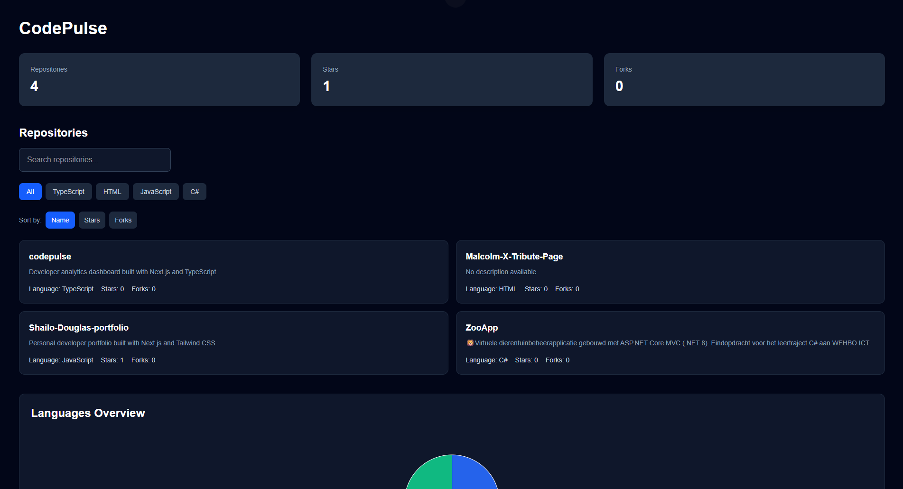

# CodePulse

**CodePulse** is a developer analytics dashboard built with Next.js, React, TypeScript, and Tailwind CSS. It integrates with the GitHub REST API to provide insights into public repositories, programming languages, repository popularity, and commit activity.

The goal of CodePulse is to present GitHub development data in a clean, interactive, and easy-to-understand dashboard.

## Live Demo

[View CodePulse Live](https://codepulse-phi.vercel.app)

## Dashboard Preview



## Features

- **GitHub Integration** – Fetch public repository data using the GitHub REST API.
- **Dashboard Statistics** – Display total repositories, stars, and forks.
- **Repository Explorer** – View repositories with descriptions, programming languages, stars, forks, and direct GitHub links.
- **Language Filtering** – Filter repositories by programming language.
- **Search** – Find repositories by name.
- **Sorting** – Sort repositories by name, stars, or forks.
- **Languages Overview** – Visualize the distribution of programming languages using a pie chart.
- **Repository Popularity** – Compare repository stars and forks using a bar chart.
- **Developer Activity** – Display recent repository commit counts using the GitHub Commits API.
- **Responsive Design** – A dark-themed dashboard designed for different screen sizes.

## Tech Stack

| Technology | Purpose |
|---|---|
| Next.js | Application framework and server-side data fetching |
| React | Component-based user interface |
| TypeScript | Type-safe development |
| Tailwind CSS | Styling and responsive layouts |
| Recharts | Interactive data visualizations |
| GitHub REST API | Repository and commit data |
| Vercel | Deployment platform |

## Getting Started

### Prerequisites

- Node.js
- npm
- Git

### Installation

Clone the repository:

```bash
git clone https://github.com/KingSD0/codepulse.git
```

Navigate to the project directory:

```bash
cd codepulse
```

Install dependencies:

```bash
npm install
```

Start the development server:

```bash
npm run dev
```

Open http://localhost:3000 in your browser.

## GitHub API Integration

CodePulse uses the public GitHub REST API to retrieve repository information and commit history.

Repository endpoint:

```text
https://api.github.com/users/KingSD0/repos
```

Commit endpoint:

```text
https://api.github.com/repos/KingSD0/{repository}/commits
```

Repository data includes names, descriptions, primary programming languages, stars, and forks.

Commit activity is calculated from the commits returned for each repository, currently limited to the 100 most recent commits per repository. These counts are not restricted to a specific author.

Public API requests are used without authentication. GitHub API rate limits apply.

## Project Structure

```text
codepulse/
├── app/
│   ├── page.tsx
│   ├── layout.tsx
│   └── globals.css
├── components/
│   └── dashboard/
│       ├── ActivityChart.tsx
│       ├── LanguageChart.tsx
│       ├── RepositoryChart.tsx
│       ├── RepositoryList.tsx
│       └── StatsCard.tsx
├── lib/
│   └── github.ts
├── types/
│   ├── repository.ts
│   └── commit.ts
├── public/
└── README.md
```

## What I Learned

Building CodePulse helped me gain practical experience with:

- Developing applications using Next.js and TypeScript.
- Fetching and processing external API data.
- Working with asynchronous functions and server-side rendering.
- Creating reusable React components.
- Managing client-side state using React hooks.
- Implementing filtering, searching, and sorting.
- Transforming API responses into chart data.
- Building responsive dashboards with Tailwind CSS.

## Future Improvements

- GitHub authentication and personalized dashboards.
- Commit activity over time.
- Additional repository analytics.
- Improved API error handling and loading states.
- Support for multiple GitHub users.

## Author

**Shailo Douglas**

Software Engineering Graduate

- GitHub: https://github.com/KingSD0
- Portfolio: https://shailo-douglas-portfolio.vercel.app

## License

This project is licensed under the MIT License.